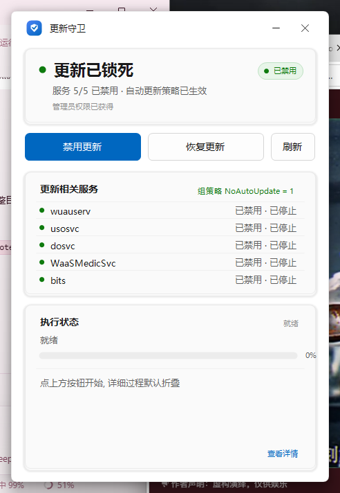
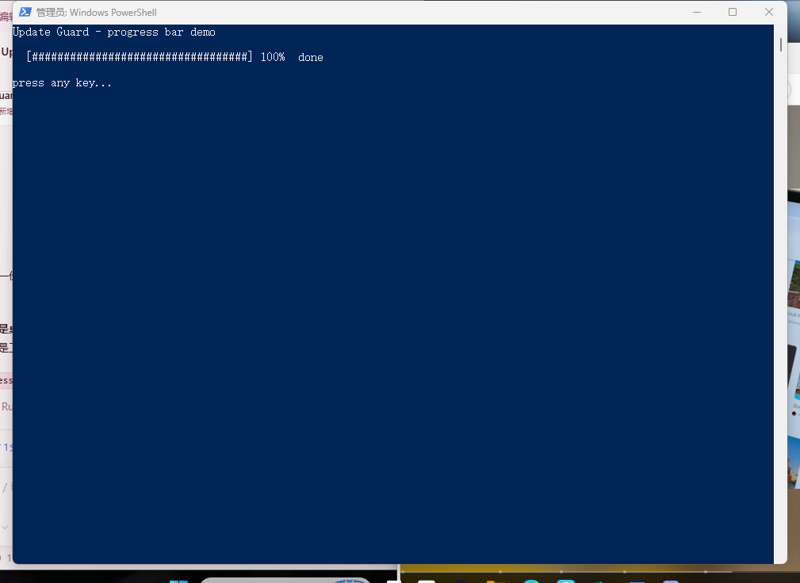

# Update Guard · 更新守卫

管理 Windows 更新与 Microsoft Store 应用自动更新，支持 Windows 10 / 11。

两种形态：**一个 PowerShell 脚本（推荐）**，以及一个 **独立的 GUI 程序**（Win11 风格，零依赖）。

[English](README.md) | **简体中文**



---

## 下载

**推荐用脚本版：[`tools/Disable-WindowsUpdate.ps1`](tools/Disable-WindowsUpdate.ps1)**（约 38 KB，纯文本）

1. 打开链接，点右上角 **Raw** 保存
2. 右键文件 → 属性 → 勾选 **解除锁定**
   （或执行 `Unblock-File .\Disable-WindowsUpdate.ps1`）
3. 右键 → **使用 PowerShell 运行** → UAC 点"是"

GUI 版挂在 [Releases](../../releases)，仓库里不放二进制。

---

## 两种形态

| | 脚本版 ✅ 推荐 | 界面版 |
|---|---|---|
| 文件 | `tools/Disable-WindowsUpdate.ps1` | `dist/UpdateGuard.exe`（Releases） |
| 体积 | 38 KB 纯文本 | ~125 KB 单文件 |
| 依赖 | Windows PowerShell 5.1 | .NET Framework 4.8（Win10/11 自带） |
| 提权 | 启动时自己请求 UAC | 点按钮时自己请求 UAC |

两者共用同一个数据目录，可以随时切换。

---

## 它改了什么

| 位置 | 内容 |
|---|---|
| `HKLM\SOFTWARE\Policies\Microsoft\Windows\WindowsUpdate` | `WUServer` / `WUStatusServer` = `http://127.0.0.1:8530`（一个不存在的地址），`DoNotConnectToWindowsUpdateInternetLocations` = 1 |
| `...\WindowsUpdate\AU` | `NoAutoUpdate` = 1，`UseWUServer` = 1 |
| `HKLM\SOFTWARE\Policies\Microsoft\WindowsStore` | `AutoDownload` = 2（关闭 Store 应用自动更新） |
| 服务 | `wuauserv`、`usosvc`、`dosvc`、`WaaSMedicSvc`、`bits` → 设为禁用并停止 |
| 计划任务 | `\Microsoft\Windows\{UpdateOrchestrator, WaaSMedic, WindowsUpdate, InstallService}\` 下全部禁用 |

受保护的任务会拒绝任务计划程序的 API，所以改为直接改写任务 XML（只动 `Settings/Enabled`），
之后通过临时给管理员补上 `Schedule` 服务的 `SERVICE_STOP` 权限来重载（用完立刻还原）。

恢复时每一步反向执行：按基线还原服务、删除策略、用备份还原任务，最后 `gpupdate /force`。

---

## 功能

- 禁用 / 恢复 Windows 更新（策略 + 5 个服务 + 4 个目录下的全部任务）
- 开关 Microsoft Store 应用自动更新
- 实时状态：服务启动类型直接问 SCM（`sc qc`），注册表键被锁也不会读错
- 进度条；逐行过程默认折叠，出错才自动展开（`-Detail` 可强制展开）
- 可完整恢复：改动前会备份任务 XML 和原始服务启动类型

---

## 构建

只需要 Windows 自带的编译器，不用装 Visual Studio，也不用 .NET SDK：

```powershell
powershell -NoProfile -ExecutionPolicy Bypass -File .\build.ps1
```

产物在 `dist\UpdateGuard.exe`。

构建脚本已经处理了几个 Windows 特有的坑：

- 自带的 `csc.exe` 是旧版编译器，只认 **C# 5**（没有字符串插值、`?.`、`nameof`、元组）
- 源码是 UTF-8，必须带 `/codepage:65001`，否则字符串字面量会变乱码
- `build\app.ico` 是构建时生成的，不进仓库

### 签名（可选）

```powershell
.\sign.ps1
```

用自签名证书签 `dist\UpdateGuard.exe`，并导出 `dist\UpdateGuard.cer`。
对方需要先跑一次 `tools\trust-cert.bat`，这样 UAC 里才不会显示"未知发布者"。
自签名证书**永远过不了** SmartScreen。

---

## 使用

### 脚本版（推荐）

```powershell
# 交互菜单（最简单的用法：右键 -> 使用 PowerShell 运行）
powershell -NoProfile -ExecutionPolicy Bypass -File .\tools\Disable-WindowsUpdate.ps1

# 非交互
... -File .\tools\Disable-WindowsUpdate.ps1 -Auto disable
... -File .\tools\Disable-WindowsUpdate.ps1 -Auto restore
... -File .\tools\Disable-WindowsUpdate.ps1 -Auto status    # 不需要提权

# 看每一步的逐行输出，而不只是进度条
... -File .\tools\Disable-WindowsUpdate.ps1 -Auto disable -Detail
```

> 脚本文件必须保持 **UTF-8 with BOM**。PowerShell 5.1 会把无 BOM 的文件按 ANSI 读，
> 中文会变成乱码并直接报语法错误。



### 界面版

双击 `UpdateGuard.exe` → 点 **禁用更新** → **再点一次确认**（5 秒内，防误触）→ UAC 点是。

---

## 目录结构

```
.
├─ src/                      C# 源码
│  ├─ Program.cs             入口 / 崩溃日志 / --selftest
│  ├─ MainForm.cs            窗口与交互
│  ├─ Theme.cs               Win11 Fluent 主题与按钮
│  ├─ WuCore.cs              禁用 / 恢复 / 状态 全部逻辑
│  ├─ Native.cs              DWM 圆角、窗口拖动
│  └─ AssemblyInfo.cs
├─ build/app.manifest        asInvoker + DPI 感知
├─ tools/
│  ├─ Disable-WindowsUpdate.ps1  PowerShell 版
│  ├─ trust-cert.ps1             把自签名证书装进本机受信任根
│  └─ trust-cert.bat             上面那个的批处理入口
├─ docs/                     截图
├─ build.ps1                 构建（生成图标 + 调 csc）
├─ sign.ps1                  签名并导出 .cer
└─ LICENSE
```

## 数据目录

`C:\ProgramData\UpdateGuard\`

| 文件 | 用途 |
|---|---|
| `log.txt` | 运行日志（两个版本共用） |
| `services.txt` | 服务启动类型基线，恢复时用 |
| `tasks\*.xml` | 每个受保护任务的原始 XML |
| `error.log` | 崩溃日志 |

卸载 = 删掉程序本体和这个目录。

---

## 已知限制

- **未签名的程序**可能被 SmartScreen 拦截（更多信息 → 仍要运行）。部分杀毒软件也会报毒，
  因为它确实会修改服务启动类型和计划任务。
- **Windows 可能会改回去一部分**。服务启动类型和计划任务会被服务栈重置，策略不受影响。
  如果发现更新又回来了，先看 `log.txt`，再跑一次即可。
- **策略挡不住手动点击**。在"设置 → Windows 更新"里主动点"检查更新"仍会发起扫描，
  只是指向一个不存在的服务器。
- 这不是打补丁的替代品。长期禁用前请自行评估安全风险。

## License

[MIT](LICENSE)
